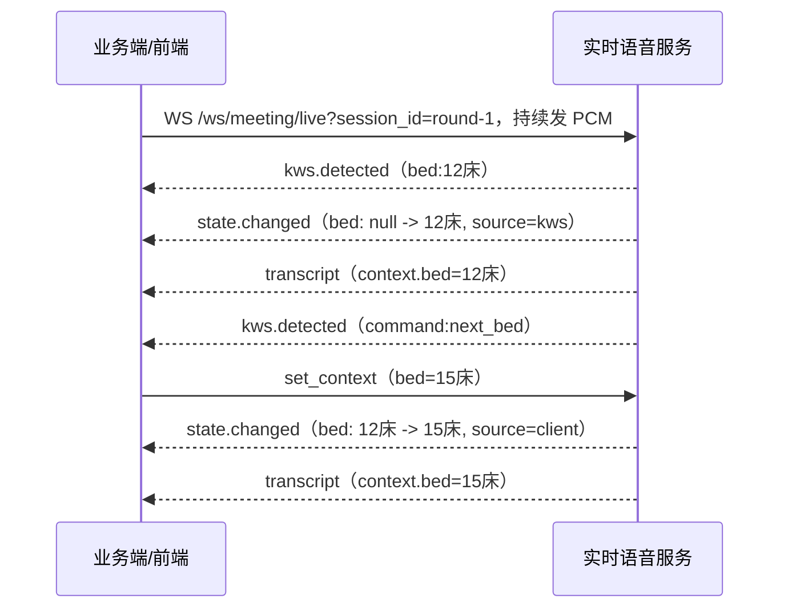

# 实时 KWS 事件交互场景说明

本文只讨论实时场景。KWS 的职责不是完整转写，而是在音频流中快速识别会改变业务状态的关键词，例如床号、病区、下一床、开始/暂停记录、查体段落标记。床号只是其中一类，设计按“类别:值”通用化。

## 设计原则：混合方案

```text
音频流
  -> KWS 旁路检测（独立推理阶段，按收包顺序）
  -> 所有命中推送 kws.detected 原始事件
  -> 命中类别是上下文槽位（如 bed）时，服务端切换该槽位并推送 state.changed
  -> transcript 按音频时间标注 context
业务端
  -> 解释指令/标记类事件（下一床、暂停记录……）
  -> 需要纠正或补设上下文时发 set_context
```

服务端只维护“显式说出的值”这种无需业务知识的最小上下文；需要查房队列、权限或确认流程的语义（“下一床”指哪一床、“结束记录”是否需二次确认）留给业务端，再通过 `set_context` 回写结果。这样服务端不猜业务，正文归属又不必由业务端自行对时间轴。

## 关键词与标签

keywords 文件每行一个关键词，`@` 标签写成 `类别:值`，命中时原样返回：

| 示例原始行 | 类别 | 含义 |
|---|---|---|
| `十二床 @bed:12床` | `bed` | 上下文槽位（默认配置） |
| `三病区 @ward:三病区` | `ward` | 上下文槽位（需加入 `KWS_CONTEXT_SLOTS`） |
| `下一床 #0.3 @command:next_bed` | `command` | 只推事件，业务端解释 |
| `开始查体 @section:查体` | `section` | 只推事件 |

- 类别名为小写字母开头的 `[a-z0-9_]`；不带冒号的旧标签按 `marker` 类别处理。
- `KWS_CONTEXT_SLOTS`（逗号分隔，默认 `bed`）中的类别是上下文槽位，其余类别只推事件。
- sherpa-onnx 不返回置信度，误触发靠每个关键词的 `:增益` 与 `#阈值` 调节；同一 `类别:值` 在 `KWS_DUPLICATE_COOLDOWN_MS`（默认 2000）内重复命中只推一次。

用 `scripts/build_kws_keywords.py` 把中文原始行转成模型 token（需 `pip install pypinyin`），token 不在模型词表中会报错退出：

```bash
python scripts/build_kws_keywords.py --tokens /models/kws/tokens.txt keywords_raw.txt keywords.txt
# 十二床 @bed:12床  ->  sh í èr ch uáng @bed:12床
```

## 事件与消息

所有 KWS 相关事件带 `session_id`、会话内递增的 `seq`、`ts_ms`、`source`。`ts_ms`、`start_ms/end_ms` 与 `transcript` 的时间同一时间轴：已保存 PCM 的累计时长，不含暂停。

### kws.detected：每次命中

```json
{
  "type": "kws.detected",
  "session_id": "round-20261030-001",
  "seq": 18,
  "ts_ms": 1840,
  "source": "kws",
  "category": "bed",
  "value": "12床",
  "start_ms": 1520,
  "end_ms": 1840
}
```

`ts_ms` 为检测到时已收音频的位置，比关键词实际结束晚约 0.2–0.45s。sherpa-onnx 连续约 1.5s 无关键词时会在内部重置，token 时间戳从重置处重新计数，Python 接口拿不到这个偏移；因此 `start_ms/end_ms` 是由 `ts_ms` 减去固定检测延迟（`DETECTION_LAG_MS`，400ms）和 token 跨度倒推出来的估计值。实测与真实起止相差在 ±0.4s 以内，多数在 0.2s 以内。拿不到 token 时间戳时，`start_ms` 为 `null`。

### state.changed：槽位取值真正变化时

```json
{
  "type": "state.changed",
  "session_id": "round-20261030-001",
  "seq": 19,
  "ts_ms": 1520,
  "source": "kws",
  "slot": "bed",
  "value": "12床",
  "previous": null
}
```

`ts_ms` 是生效时刻：KWS 来源取关键词起点，客户端来源取收到 `set_context` 时的音频位置。`source` 为 `kws` 或 `client`。只在当前值（时间上最晚的一次设置）改变时推送，重复说同一床号、重复设置都不推送。

KWS 有约 0.2–0.45s 的检测延迟。若这段时间内客户端已 `set_context`，晚到的槽位命中起点早于客户端设置：它只修正该时段片段的 `context`，不改变当前值、不推 `state.changed`，`kws.detected` 照常推送。

### transcript：标注上下文

KWS 启用时，每条 `transcript` 增加：

```json
{
  "type": "transcript",
  "segmentId": "segment-3",
  "isFinal": true,
  "start_ms": 2100,
  "end_ms": 5200,
  "text": "今天体温正常，继续观察。",
  "context": {"bed": "12床"},
  "contextChanged": false
}
```

- `context` 取片段起点后 1s 内（`CONTEXT_LEAD_MS`）的最终取值，因为 VAD 起点通常略早于关键词，“12床，今天体温正常”这句应归 12床。
- `contextChanged=true` 表示片段其余时段内槽位又变了（如一段话中间说了“15床”），该片段归属需业务端或人工确认。
- 在发送时按时间段计算，不受 KWS 检测延迟影响；interim 与 final 都带，KWS 未启用时不出现这两个字段。

### set_context：业务端纠正或补设

```json
{"type": "set_context", "slot": "bed", "value": "15床"}
{"type": "set_context", "slot": "bed", "value": null}
```

- 在当前音频位置生效，影响之后的片段；值为 1–64 字符字符串（首尾空白会去掉）或 `null` 清空。
- 未启用 KWS、未知槽位或值非法时回复 `error`，不改状态。
- 典型用途：业务端收到 `command:next_bed`，按查房队列算出 15床后回写；医生手动点选病人；KWS 识别错时纠正。

## 场景 A：只用事件

业务端只需要实时知道床号或指令，正文由其他系统处理。

| 收到 | 业务动作 |
|---|---|
| `state.changed`（bed） | 校验床号在当前查房队列中，UI 切换病人；不在队列时提示，必要时 `set_context` 纠正 |
| `kws.detected`（command:next_bed） | 按队列找下一床，`set_context` 回写 |
| `kws.detected`（command:pause_recording 等） | 业务端发 `pause_recording` 等控制消息；结束类命令建议二次确认 |
| `kws.detected`（section、marker） | 打时间点标记 |

优点是边界清楚、KWS 出错不影响转写；限制是只解决“状态切换”，不解决“说了什么”。

## 场景 B：事件 + 实时转写

业务端实时展示正文并按 `context` 归属：



业务端处理 transcript：

```text
1. 同一 segmentId 按 revision 覆盖，isFinal 后入草稿。
2. 按 context 归属；槽位为 null 放“未归属”，contextChanged=true 标记待确认。
3. 保存 start_ms/end_ms 便于回听；医疗内容仍需人工复核。
```

限制：KWS 与 ASR 都可能出错；床号关键词本身仍会出现在正文中，是否剔除由业务端决定。

## 运行约定

- 入口：`WS /ws/meeting/live`，可用 `session_id` 查询参数指定会话 ID，缺省时服务端生成 `live-<uuid>`。
- KWS 在独立的单线程 `kws` 推理阶段运行，所有会话共享，积压可在 `/v1/live/metrics` 的 `kws` 阶段观察。
- 准入降级为只录音的会话照常做 KWS（没有 `transcript`，但有 `kws.detected`/`state.changed`，`set_context` 可用）。
- 单个会话 KWS 出错时推送 `status`（`phase=kws_unavailable`）并停止检测；转写、录音和 `set_context` 不受影响。
- KWS 默认关闭；`KWS_ENABLED=1` 时配置必须完整、模型必须能加载，否则服务启动失败，不静默降级。

```bash
KWS_ENABLED=1
KWS_TOKENS_PATH=/app/models/kws/tokens.txt
KWS_ENCODER_PATH=/app/models/kws/encoder.onnx
KWS_DECODER_PATH=/app/models/kws/decoder.onnx
KWS_JOINER_PATH=/app/models/kws/joiner.onnx
KWS_KEYWORDS_FILE=/app/models/kws/keywords.txt
KWS_PROVIDER=cpu
KWS_NUM_THREADS=1
KWS_CONTEXT_SLOTS=bed
KWS_DUPLICATE_COOLDOWN_MS=2000
```

## 模型与验证现状

推荐 `sherpa-onnx-kws-zipformer-zh-en-3M-2025-12-20`（中英混合，约 3M 参数）；`wenetspeech-3.3M-2024-01-01` 也可用。依赖 `sherpa-onnx>=2.0.1`。

已验证（macOS TTS 合成音频，单 CPU 线程）：两个模型均能检出“十二床”“十五床”“下一床”“体温”，RTF 约 0.006；“二床/十二床”“一床/下一床”在该样本上没有互相误触发；接入服务后时间轴与 `context` 标注正确。

2026-10-30 在 xfusion 上用隔离实例测试，结果如下：

- 检测延迟（从关键词结束到客户端收到）：p50 274ms，p95 399ms。
- 误报：约 49 分钟真实会议录音中，`kws.detected` 为 0 次。
- 8 路并发：kws 阶段平均 wait 为 3ms，排队集中在 nano 阶段。
- 准入降级为只录音的会话照常推送事件。

未验证：真实病房语音的召回率，以及 8 路以上并发时 `kws` 阶段的负载。“暂停记录”在部分上下文中漏检，上线前需要用真实录音调整关键词的增益和阈值。
